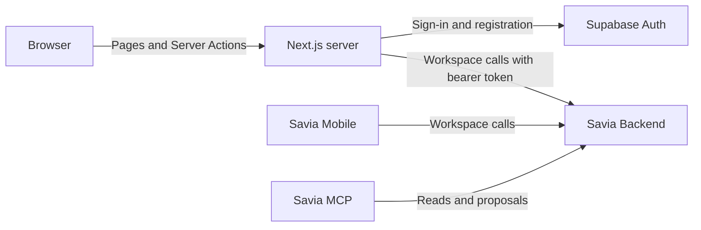

<!-- markdownlint-disable-next-line MD041 -->
<div align="center">

<h1>Savia Web</h1>

<p><strong>A browser workspace for tracking personal accounts, spending, and budgets.</strong></p>

<p>
<a href="https://github.com/diegnghtmr/savia-web/actions/workflows/ci.yml"></a>


<a href="LICENSE"></a>
</p>

<p>
<a href="https://diegnghtmr.me/en/work/savia/"><strong>Case study</strong></a> &bull;
<a href="#quick-start"><strong>Quick start</strong></a> &bull;
<a href="#architecture"><strong>Architecture</strong></a> &bull;
<a href="https://github.com/diegnghtmr/savia-backend"><strong>Backend API</strong></a> &bull;
<a href="https://github.com/diegnghtmr/savia-mobile"><strong>Mobile app</strong></a> &bull;
<a href="https://github.com/diegnghtmr/savia-mcp"><strong>MCP server</strong></a>
</p>

</div>

Savia Web gives people who track their own money a place to see what's in each account, record where it went, and plan what remains. It starts with registration and personal workspace setup; financial requests go through the Next.js server using the signed-in user's session.

## Features

- **Account setup.** Register or sign in with Supabase Auth, then choose your workspace name, base currency, and display preferences.
- **Ledger workspace.** View balances, record transactions and transfers, and manage exchange rates.
- **Budget planning.** Set up budgets, sinking funds, and debts alongside recorded activity.
- **Financial views.** Explore spending, cash flow, and other workspace analytics.
- **Document workflows.** Import records, review receipts, and generate reports inside the workspace.

## Quick start

Use Node.js **24.18.0** and pnpm **11.15.1**, pinned in [mise.toml](mise.toml). For sign-in and workspace features, you need a Supabase Auth project and a running [Savia API](https://github.com/diegnghtmr/savia-backend). Set these in the server environment, not in public client-side variables:

| Variable | Purpose | Default |
| --- | --- | --- |
| `SUPABASE_URL` | Supabase project URL. | None |
| `SUPABASE_ANON_KEY` | Publishable or legacy anonymous key for Supabase Auth, not a service-role key. | None |
| `BACKEND_BASE_URL` | Base URL of the Savia API reachable from Next.js. | None |

```sh
git clone https://github.com/diegnghtmr/savia-web.git
cd savia-web
pnpm install --frozen-lockfile --strict-peer-dependencies
pnpm build
pnpm start
```

Open `http://localhost:3000`. Use a different backend port if both services run on the same host.

## Architecture

The browser renders public, authentication, and workspace pages through Next.js. The server uses HTTP-only session cookies for workspace actions and forwards the session's access token to the API. Mobile uses the same API independently; neither it nor MCP depends on the web server.



## Tech stack

| Layer | Technology |
| --- | --- |
| Web | Next.js 16.2.11, React 19.2.8, TypeScript 6.0.3 |
| Styling | Tailwind CSS 4.1.18 |
| Auth | Supabase JavaScript client 2.110.9+ and SSR helpers 0.12.3+ |
| Quality | Vitest 4.1.10, Playwright 1.61.1, axe-core |

## Testing

```sh
pnpm check
pnpm test:unit
pnpm test:server
pnpm test:component
pnpm test:design
pnpm test:audit
pnpm verify:font
pnpm exec playwright install chromium
pnpm build && pnpm test:e2e
```

CI checks formatting, types, lint, package peers, the bundled font, and the unit, server, component, design, and audit suites. Browser tests start the previously built app with loopback Supabase Auth and Savia API fixtures, and include an accessibility gate.

On a busy Linux host, `pnpm build && pnpm test:e2e:isolated` starts the app on port 3000 and the fixture on 4010 inside a loopback-only namespace. It requires `unshare` (util-linux), `ip` (iproute2), and permission to create unprivileged user and network namespaces. If those are unavailable, use `pnpm test:e2e` on a stable host.

## Project structure

```text
src/app/   Public, authentication, onboarding, and workspace pages and actions
src/lib/   Server configuration, sessions, and HTTP gateways
tests/     Vitest suites
e2e/       Playwright tests and local service fixtures
supabase/  Local Supabase configuration
```

## Related repositories

- [savia-backend](https://github.com/diegnghtmr/savia-backend) — HTTP API and background worker.
- [savia-mobile](https://github.com/diegnghtmr/savia-mobile) — Expo app for Android and iOS.
- [savia-mcp](https://github.com/diegnghtmr/savia-mcp) — MCP interface for reads and proposals.
- [savia-cli](https://github.com/diegnghtmr/savia-cli) — command-line client.

## License

[MIT](LICENSE). The bundled Inter font is covered separately by the [SIL Open Font License](LICENSES/Inter-OFL-1.1.txt).
